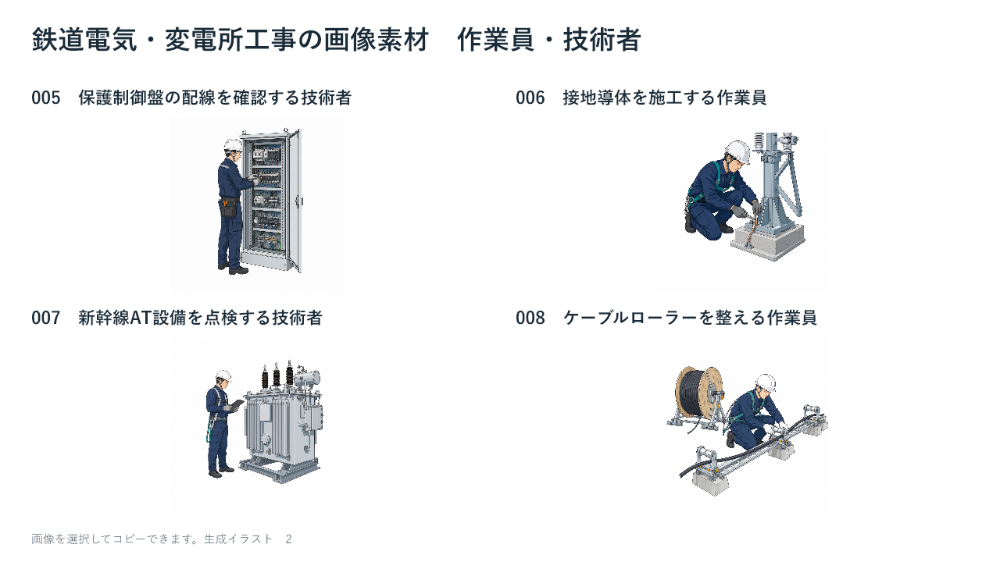
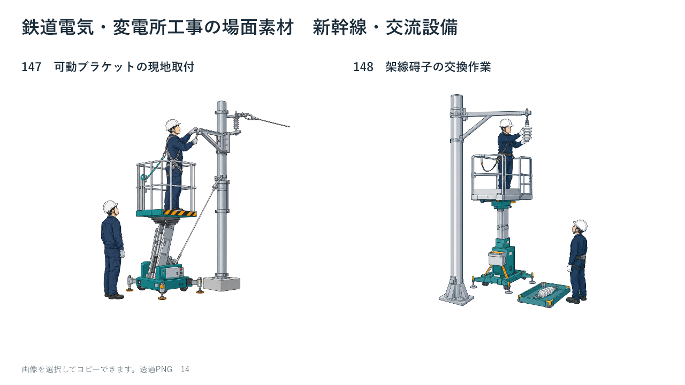
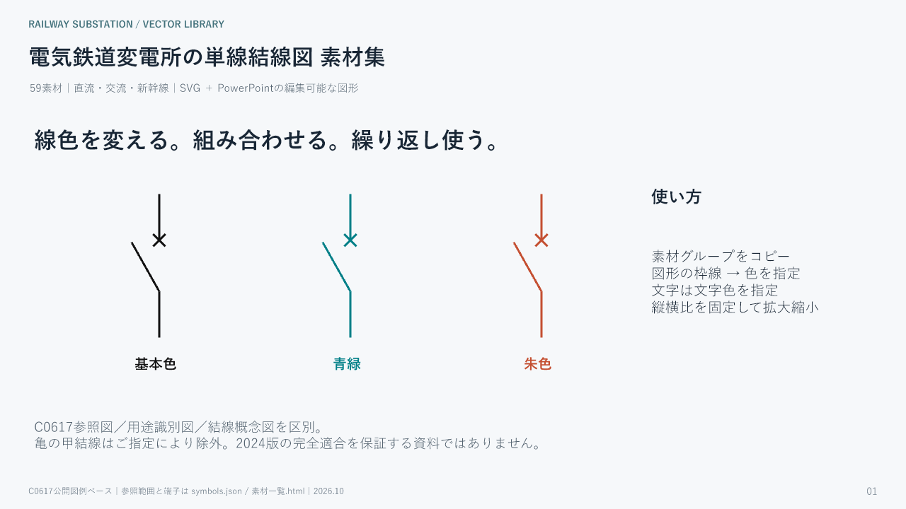

# 鉄道電気・変電所工事の素材集 / Railway Electrical Assets

**CC0 1.0 Universal — 商用利用・改変・再配布可。クレジット表記不要。**

鉄道電気工事・変電所工事の説明資料に使える、透過PNG170点とSVG59点の素材集です。直流鉄道、交流鉄道、新幹線を含みます。

## ダウンロード

素材本体とPowerPointは [Releases](https://github.com/Shikashima/railway-electrical-assets/releases/tag/v1.0.0) に収録しています。ZIPを展開してから、各フォルダーのHTML一覧またはPPTXを開いてください。GitHubの「Code → Download ZIP」はこの案内リポジトリのみで、素材本体を含みません。

| パッケージ | 収録内容 | ダウンロード |
|---|---|---|
| 人物・工具・設備 | 透過PNG120点、PowerPoint30ページ、検索できるHTML一覧 | [ZIP](https://github.com/Shikashima/railway-electrical-assets/releases/download/v1.0.0/railway-people-objects-120-cc0.zip) |
| 工事・試験場面 | 透過PNG50点、PowerPoint26ページ、検索できるHTML一覧 | [ZIP](https://github.com/Shikashima/railway-electrical-assets/releases/download/v1.0.0/railway-work-scenes-50-cc0.zip) |
| 単線結線図・図記号 | SVG59点、編集可能なPowerPoint17ページ、色を変更できるHTML一覧 | [ZIP](https://github.com/Shikashima/railway-electrical-assets/releases/download/v1.0.0/railway-substation-symbols-59-cc0.zip) |

PNGはすべて1024×1024の背景透過画像です。PNGの部品ごとの色変更には対応していません。SVGと図記号のPowerPointでは線や文字の色を変更できます。

## 見本

### 人物・工具・設備

### 新幹線・交流設備の工事場面

### 編集可能な電気図記号

## CC0と制作情報

公開者Shikashimaは、本配布物について自ら保有する著作権および関連する権利を、法令上認められる最大限の範囲でCC0 1.0 Universalに基づき放棄します。帰属表示は必須ではありません。CC0による放棄・許諾は取り消せません。

- [CC0全文](LICENSE) / [日本語の概要](https://creativecommons.org/publicdomain/zero/1.0/deed.ja)
- [制作情報と適用範囲](PROVENANCE.html)
- [全229点のカタログデータ](catalog.json) / [配布ZIPのSHA-256](SHA256SUMS)

PNGはgpt-image-2で生成したAIイラストで、背景除去と補正はローカルで実施しました。SVGは公開図例を参照して再作図しています。参照資料や規格本文そのものは配布しておらず、その第三者の権利にCC0を適用するものではありません。

説明資料向けの素材です。実際の機器構造、施工手順、安全措置の正確性や、JIS C0617の2024年版への完全適合を保証しません。施工図・設計図として使う場合は別途確認してください。無保証で提供します。

## English

170 transparent PNG illustrations (1024×1024), 59 SVG electrical symbols, and three PowerPoint catalogs for railway electrical and traction-substation presentations. Includes DC railway, AC railway, and Shinkansen subjects. Download the asset ZIP files from Releases; this source repository contains documentation, the catalog and previews only.

Dedicated under CC0 1.0 Universal to the extent of rights held by the publisher. Attribution is not required. PNG illustrations are AI-generated; symbols are redrawn with references. Third-party standards, trademarks, patents and source publications are not relicensed. These are explanatory presentation assets, not certified standards drawings or validated construction instructions.
